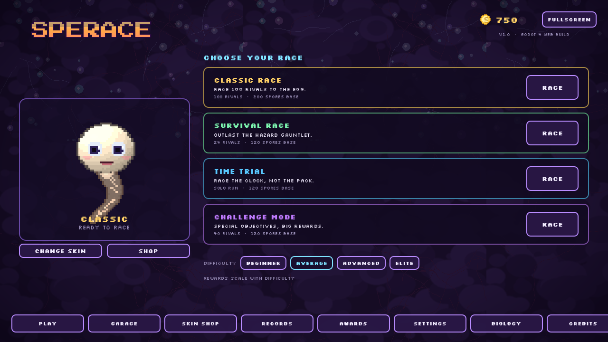

# SPERACE

**A fast, funny, 32-bit-styled microscopic arcade racer.**
101 cells. One giant egg. One golden crown. Built with **Godot 4.4 (GDScript, Compatibility renderer)** and shipped as a **playable browser game**.



---

## 1. Play it right now

The finished browser build lives in [`Web_Build/`](Web_Build). Browsers refuse to load
WebAssembly from `file://`, so serve the folder over HTTP:

```bash
# easiest: the bundled server (also sets the wasm mime type + PWA headers)
cd SPERACE
python3 serve.py            # opens http://localhost:8099

# or any static server
cd Web_Build && python3 -m http.server 8099
```

Any static host works (GitHub Pages, Netlify, Vercel, itch.io, S3, nginx, Apache).
No installation, no plugin, no account, no internet connection required after the files load.

### Controls

| Key | Action |
| --- | --- |
| **W A S D** / arrow keys | Swim in any direction (360° momentum) |
| **Space** | Boost (drains the boost cell, recharges when you stop) |
| **Left mouse button held** | Alternative steering — the cell swims toward the pointer |
| **Right mouse button held** | Alternative boost |
| **Esc** / **P** | Pause menu |
| **R** | Restart the race |
| **F** | Toggle fullscreen |

---

## 2. What is in the game

### Racing
* **101 competitors** in Classic Race: you versus **100 independently simulated AI cells** — no fake or scripted bots. Every rival has its own name, skin, personality, skill value, route choice, hazard-avoidance scan and boost strategy.
* **Dynamic golden crown** that floats above whoever is actually leading, based on true race progress (not screen position). It flips to a new leader the instant the ranking changes, with a bounce, sparkles, a chime and a **“NEW LEADER”** callout. The leaderboard shows the same crown icon beside the leader.
* **Six biomes** in one continuous course: Starting Zone → Narrow Passage → Fluid Currents → Danger Zone → Final Passage → Egg Arena.
* **Branching routes** (short-but-dangerous, safe detour, power-up lane, risk shortcut, recharge lane) that are split by solid tissue islands, so route choice genuinely matters.
* **Hazards**: rotating energy bars, drifting cells, spiky viruses, immune patrol cells that sweep the corridor, sticky patches, debris — all with real collision, knockback, stun, slow, control scramble and damage.
* **10 power-ups**: Turbo, Shield, Energy Cell, Magnet, Ghost, Dash, Stabilizer, Recovery, Teleport Bubble, Lucky Star. The AI collects them too.
* **Elimination**: a cell at 0 HP bursts, spins out and leaves the race — the leaderboard, crown and pack size all update.
* Random race events: turbulence, low-visibility sections, bonus power-up spawns, current shifts, energy surges.
* **Final stretch**: music swaps to the intense track, the announcement banner fires, and the egg arena fills the view.

### Four complete modes
| Mode | What actually happens |
| --- | --- |
| **Classic Race** | 101 racers, first to the egg wins, crown tracked live |
| **Survival Race** | 25 racers, hazards intensify over time; eliminated = run over; survival time recorded |
| **Time Trial** | Solo run against the clock, personal best saved, **ghost replay** of your best run |
| **Challenge Mode** | 5 objectives with live in-HUD progress: win without boosting, clean run, collect 10 power-ups, top 3, sub-55 s |

### Progression
* **24 hand-tuned skins** (Classic, Ocean, Toxic, Sunset, Midnight, Golden, Diamond, Neon, Galaxy, Fire, Ice, Rainbow + 12 more) with rarity tiers, prices, unlock hints, live animated previews and a working shop. Skins are cosmetic only — bots use randomized skins and never gain stats.
* **Spores** (currency) from placements, podiums, power-ups, eliminations and challenge bonuses.
* **12 achievements** with progress bars and payout rewards.
* Stats, best times, crown-hold record, race history, settings — all stored in `user://`, which the web build maps to **IndexedDB**, so progress survives reloads (verified).

### Look and feel
* ~5 200 lines of GDScript across 12 scripts, fully modular (`RaceManager`, `Racer`, `Track`, `WorldRender`, `RaceHUD`, `Skins`, `Saves`, `Audio`, `Game`, `Fx`, `UITheme`, `MainMenu`).
* All art is original, generated by code: per-pixel character renderer with banded shading, rim light, specular highlights, dithered texture and 20 animation frames per skin (swim, boost, turn, hurt, cheer, blink). Obstacles, power-ups, egg, crown, UI kit, particles — all generated.
* All music and SFX are synthesized from scratch (numpy additive/subtractive synthesis → Ogg Vorbis): menu, race and final-stretch loops, ambient bed, plus 15 SFX.
* Branded HTML shell with a progress-bar loading screen, keyboard focus handling and PWA manifest.

---

## 3. Project layout

```
SPERACE/
├── Godot_Project/            <- open this in Godot 4.4+
│   ├── project.godot
│   ├── export_presets.cfg    <- Web preset (single-threaded, PWA enabled)
│   ├── scenes/               main_menu.tscn, race.tscn, race_hud.tscn
│   ├── scripts/
│   │   ├── autoload/         skins.gd, saves.gd, audio.gd, game.gd, fx.gd
│   │   ├── race/             track.gd, racer.gd, race_manager.gd,
│   │   │                     world_render.gd, race_hud.gd
│   │   └── ui/               ui_theme.gd, main_menu.gd
│   ├── assets/
│   │   ├── sprites/          characters, obstacles, power-ups, UI, FX (PNG)
│   │   ├── audio/            music + SFX (Ogg Vorbis)
│   │   ├── fonts/            Silkscreen, Press Start 2P (SIL OFL)
│   │   └── web/              custom HTML shell for the web export
│   └── resources/            audio bus layout
├── Web_Build/                <- the playable HTML5 build
│   ├── index.html            loading screen + engine boot
│   ├── index.js              Godot web loader
│   ├── index.wasm            engine (WebAssembly)
│   ├── index.pck             game data
│   ├── index.manifest.json   PWA manifest (+ icons, service worker)
│   └── index.audio.worklet.js, index.offline.html, ...
├── serve.py                   <- tiny local web server for the build
├── screenshots/
└── README.md
```

### Regenerating the art / audio
The generators are pure Python and deterministic:

```bash
cd SPERACE/tools
python3 gen_art.py       # characters, obstacles, power-ups, egg, crown, UI, logo
python3 gen_fx_art.py    # particle textures
python3 gen_audio.py     # music + SFX (needs numpy + ffmpeg)
```

---

## 4. Editing and re-exporting

1. Install **Godot 4.4.x** (standard build) and open `Godot_Project/project.godot`.
2. Install the export templates once: *Editor → Manage Export Templates → Download*.
3. Edit anything, then:

```bash
godot --headless --export-release "Web" /path/to/SPERACE/Web_Build/index.html
# or use Editor → Project → Export → Web → Export Project
```

The preset is already tuned for browsers: **Compatibility renderer, WebGL 2, single-threaded**
(no COOP/COEP headers needed), PWA enabled. Serve the output folder over HTTP.

---

## 5. Performance notes (101 racers in a browser)

The simulation never uses rigid bodies or physics servers. `Racer` is a `Node2D` with a
custom momentum model, and everything expensive is amortised:

* **Immutable corridor**: the track is a sampled centre line + half-width array, so wall
  collision is O(1) instead of polygon tests.
* **Spatial hashing** for racer–racer contacts (O(n) instead of O(n²)).
* **Precomputed hazard density field** — bots score lanes with three array lookups instead of
  iterating nearby obstacles every frame.
* **Staggered AI**: each bot re-plans every 55–160 ms (skill dependent), not every frame.
* **Bucket-grid** lookups for obstacles and pickups, plus camera-frustum culling for sprites.
* **Visual LOD**: racers far off camera update their sprite every 2nd–3rd frame.
* **Pooled FX** (46 reused sprites), pooled audio players (12), no per-frame allocations in
  the hot path.
* Corridor redraws throttled to ~16 Hz; obstacle/pickup animation is per-sprite, not per-draw-call.

Measured: headless simulation of a full 101-racer race sustains **~145 updates/s** on a
2-vCPU container; rendering is GPU-bound and holds 60 FPS on normal desktop hardware.

---

## 6. QA performed on the delivered build

Verified in a headless Chromium (WebGL 2 / SwiftShader) against the exact files in `Web_Build`:

* Boots with no WebAssembly errors and **zero runtime errors** across menu → race → results → restart.
* All four modes start, simulate and produce a results screen.
* 101 racers spawn and race; rankings, live leaderboard and the crown stay in sync.
* Keyboard (WASD + Space + Esc + R + F) **and** mouse steering both drive the player.
* Obstacle collisions, pickups, boosts, eliminations, random events and challenge objectives fire.
* Shop purchase → currency deducted → **survives a full page reload** (IndexedDB).
* All eight menu screens render (Play, Garage, Skin Shop, Records, Awards, Settings, Biology, Credits).
* Loading screen shows real progress; layout adapts at 1920×1080, 1366×768 and 1024×768
  (canvas scaling, no stretched artwork).

---

## 7. Credits

* **Design, code, art and audio**: created for this project — every sprite is procedurally
  rendered and every sound synthesized, no third-party game assets.
* **Engine**: [Godot 4.4.1](https://godotengine.org) (MIT).
* **Fonts**: Silkscreen and Press Start 2P (SIL Open Font License).

*Sperace is a cartoon. Its “biology” is stylised for fun — real cell biology is far more
interesting, and the in-game **Biology** tab explains the honest basics.*
